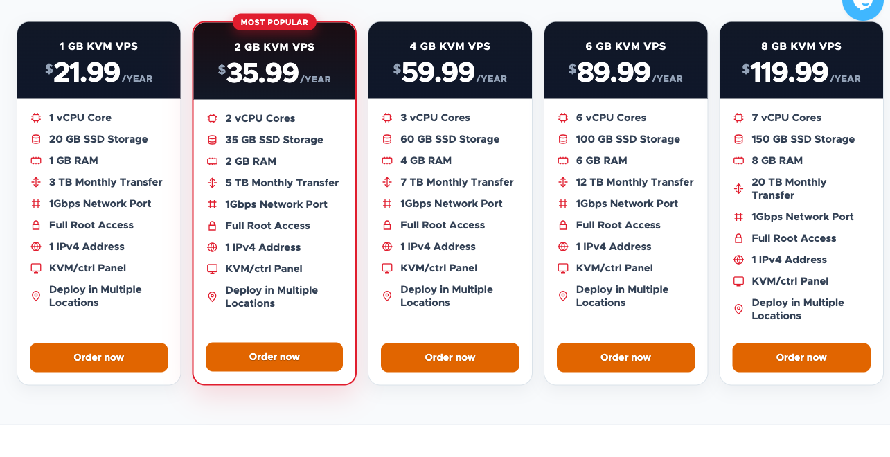
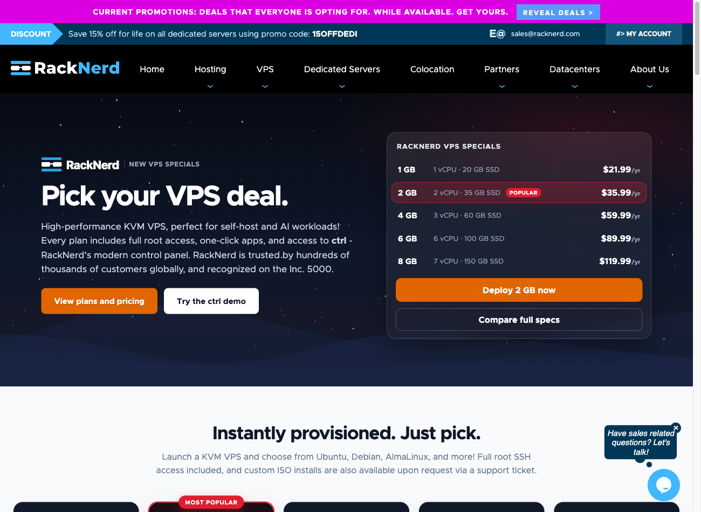
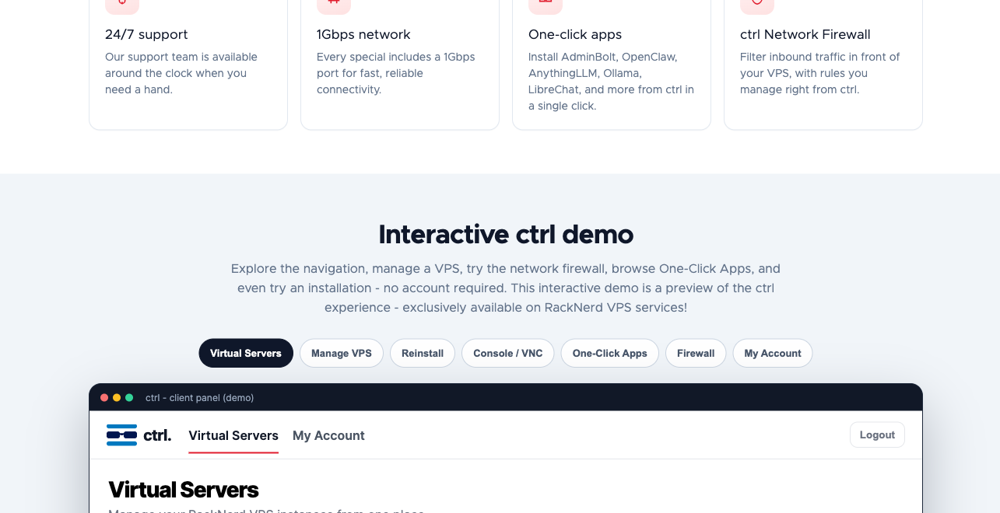
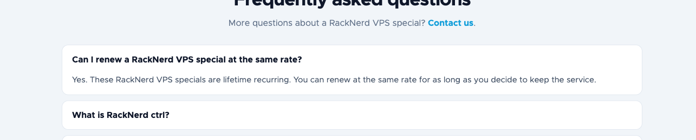

# RackNerd VPS 评测 2026：低价年付 VPS，$21.99/年起

如果你正在找一台价格低、能长期在线、适合建站或跑轻量服务的海外 VPS，RackNerd 是比传统高价云服务器更容易控制预算的选择。它的优势不是复杂的云功能，而是把一整年的成本直接压到一个清楚的数字：公开活动套餐从 **$21.99/年** 起，续费仍按活动价。

[查看 RackNerd 年付 VPS 套餐](https://my.racknerd.com/aff.php?aff=21833)

## RackNerd 值得买吗？

**结论：适合预算有限、准备长期保留一台小服务器的人。** 如果你要搭个人网站、博客、监控、Telegram Bot、代理后端、轻量 Docker 服务或 Linux 学习环境，1GB 或 2GB 年付套餐都很有吸引力。

- **1GB：$21.99/年**，适合静态站、博客、监控和练手；
- **2GB：$35.99/年**，更适合 WordPress、小型面板和多进程应用；
- **4GB：$59.99/年**，适合多个轻量服务或更宽松的内存需求；
- 套餐均列有 KVM、独立 IPv4、1Gbps 端口、root 权限与多个可选机房。

这类年付 VPS 的购买逻辑很直接：不用每月反复续费，一次付款就能把全年成本锁定下来。若你只用一两个月，月付云服务器更灵活；若准备持续使用，RackNerd 的年付总额通常更好算账。

## RackNerd 与 Vultr、DigitalOcean 有什么区别？

Vultr、DigitalOcean 更像按小时计费的开发云平台，控制台、API 和周边云服务更完整；RackNerd 更像一台简单、便宜、长期放着运行的 VPS。

| 需求 | 更适合的方向 |
|---|---|
| 经常创建、删除服务器，按小时结算 | Vultr / DigitalOcean 类云平台 |
| 一台机器长期运行，优先压低全年成本 | RackNerd 年付 VPS |
| 需要对象存储、托管数据库等完整云产品 | 综合云平台 |
| 建站、监控、Bot、轻量服务、Linux 练习 | RackNerd |

因此，RackNerd 不是要替代所有云平台，而是为“不需要复杂云服务，只想要一台便宜 VPS”的用户提供更直接的方案。

## 套餐怎么选？

### 1GB 套餐：最低成本入门

1GB KVM 套餐包含 1 vCPU、20GB SSD、每月 3TB 流量，年付 $21.99。适合 Nginx 静态站、轻量博客、Uptime Kuma、简单脚本和学习 Linux。

### 2GB 套餐：最均衡

2GB 套餐包含 2 vCPU、35GB SSD、每月 5TB 流量，年付 $35.99。内存比入门款宽裕，更适合 WordPress、Docker 小应用和多个后台进程。

### 4GB 及以上：多服务部署

4GB、6GB、8GB 档位适合同时运行多个服务。选购时不要只看内存，也要结合应用的 CPU、磁盘和数据库负载。

[进入 RackNerd 当前活动页面](https://my.racknerd.com/aff.php?aff=21833)

## 机房与使用方式

RackNerd 套餐支持多个部署地点。购买时直接在可选机房中选择离主要访客或业务更近的位置；面向北美用户的网站优先考虑美国机房，跨地区业务则应根据实际访问对象决定。

开通后可通过控制面板重装系统、管理 VPS、打开控制台并配置防火墙。第一次使用建议选择 Ubuntu 或 Debian，先更新系统，再安装 Nginx、Docker 或所需应用。

## RackNerd 续费会涨价吗？

RackNerd 在 specials 页面 FAQ 中写明，这些 VPS 活动套餐为 recurring，保留服务期间可以按同一价格续费。对长期使用者来说，这一点比只看首年低价更重要。

## 适合哪些人？

- 想用较低预算拥有一台全年在线 VPS；
- 用来建站、跑监控、Bot、脚本或轻量 Docker；
- 需要 root 权限和独立 IPv4；
- 可以自己维护 Linux、备份数据和处理应用配置。

## 购买建议

第一次使用，优先从 1GB 或 2GB 开始：纯静态站和练手选 1GB；WordPress、Docker 或多个进程选 2GB。不要因为单价低就直接买最大配置，先让真实负载跑起来，再决定是否升级。

**想控制全年 VPS 成本，RackNerd 的 $21.99/年套餐是一个很直接的起点。**

[查看 RackNerd VPS 优惠与可选机房](https://my.racknerd.com/aff.php?aff=21833)

## 常见问题

### RackNerd 是月付还是年付？

本文介绍的是年付活动套餐，付款时一次支付完整年度费用。

### RackNerd VPS 能建网站吗？

可以。常见做法是安装 Ubuntu 或 Debian，再部署 Nginx、WordPress、宝塔面板或 Docker 应用。

### 1GB 内存够用吗？

静态站、轻量博客、监控和简单脚本通常可以从 1GB 开始；WordPress、多容器或数据库应用更适合 2GB 及以上。

### RackNerd 适合长期使用吗？

如果应用可以自主管理、定期备份，并且年付模式符合预算，它很适合作为低成本常驻 VPS。
